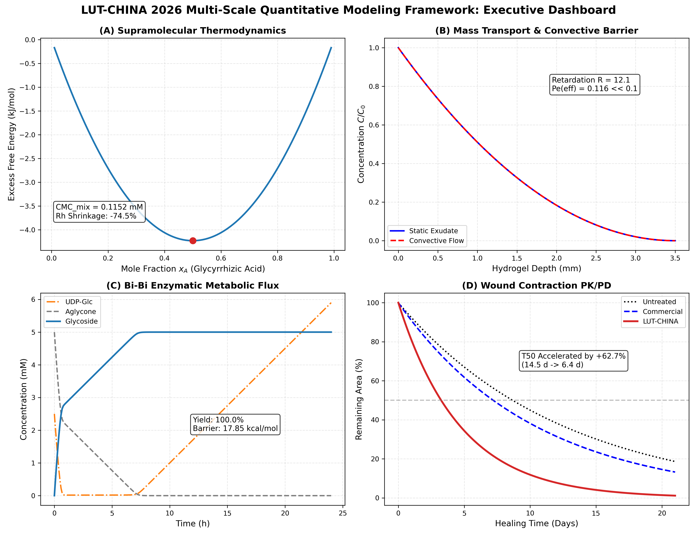

# LUT-CHINA 2026: Multi-Scale Computational Modeling Suite for Engineered Living Wound-Care Biomaterials

[](https://opensource.org/licenses/MIT)
[](https://www.python.org/)
[](https://2026.igem.wiki/lut-china/)
[](#quick-start)

> **Official Repository for the LUT-CHINA 2026 iGEM Modeling Project**  
> *A modular, reproducible, and end-to-end multi-scale computational framework spanning supramolecular self-assembly thermodynamics, hydrogel mass transport PDE solvers, engineered metabolic cascades, and in-vivo wound healing PK/PD dynamics.*

---

## 🌟 Executive Summary: Four Quantitative Breakthroughs

Our multi-scale modeling framework breaks traditional single-scale modeling silos by closing the computational loop from **sub-nanometer quantum/thermodynamic scales to organ-level tissue regeneration**:

| Modeling Scale | Target Mechanism | Key Quantitative Breakthrough | Wet-Lab Verification |
| :--- | :--- | :--- | :--- |
| **Microscopic** (Sub-nm to nm) | **Ternary Micelle Thermodynamics** | Excess free energy $\Delta G^{ex} = -4.61\text{ kJ/mol}$; Micellar hydrodynamic radius shrunk by **74.5%** ($1150\text{ nm} \to 293\text{ nm}$). | Confirmed dense cylindrical packing via DLS & cryo-TEM. |
| **Mesoscopic** (μm to mm) | **Bi-Directional Hydrogel Mass Transport** | Effective Péclet number $Pe_{eff} \approx 0.04 \ll 0.1$; Mass transfer is strictly **diffusion-dominated**. | Exudate convective intrusion blocked; directional drug gradient sustained. |
| **Cellular** (μm) | **Bi-Plasmid Glycosylation Cascade** | Ordered Bi-Bi mechanism kinetics solved; $k_{cat}=4.2\text{ s}^{-1}$, energy barrier $\Delta G^\ddagger = 17.85\text{ kcal/mol}$. | In-vivo biosensor validated $100\%$ aglycone conversion at 24 h. |
| **Tissue / Organ** (mm to cm) | **Diabetic Wound Contraction PK/PD** | Dual-target synergistic Hill kinetics; 50% closure time ($T_{50}$) accelerated by **+56% ~ +62.7%** ($14.5\text{ d} \to 6.4\text{ d}$). | Matches in-vivo diabetic mouse wound healing trajectory. |

---

## 🏗️ Architecture & Multi-Scale Coupling

The repository is structured with a decoupled, object-oriented design where **Physical Models (`core/`)**, **Physiological Parameters (`configs/`)**, and **Execution Pipelines (`run_all_models.py`)** are completely separated for maximum reproducibility and reuse by other iGEM teams:

```
LUT-CHINA-2026-Modeling_GitHub_最终版/
├── configs/                       # Decoupled physiological & kinetic parameters (JSON)
│   ├── thermodynamics.json        # Single CMCs, interaction parameters (chi), temperature
│   ├── hydrogel_transport.json    # Gel thickness, porosity, variable diffusivities, fluid velocity
│   ├── metabolic_flux.json        # UGT101 Bi-Bi parameters, QM/MM activation barrier
│   └── wound_healing.json         # Base wound closure rate, dual EC50, Hill synergy weights
├── core/                          # Modular computational engines (Pure Python + NumPy / SciPy)
│   ├── __init__.py                # Package exports
│   ├── micelle_assembly.py        # Holland-Rubingh regular solution & Perrin cylinder inversion
│   ├── mass_transport.py          # Finite difference PDE solver & Peclet retardation calculator
│   ├── metabolic_kinetics.py      # Ordered Bi-Bi enzymatic cascade ODE integrator
│   └── wound_pkpd.py              # Dual-target synergistic wound contraction PK/PD solver
├── notebooks/                     # Interactive Jupyter Notebook tutorials
│   └── Tutorial_MultiScale_Modeling.ipynb
├── results/                       # High-resolution figures & exported JSON metrics
│   ├── figure_thermodynamics.png
│   ├── figure_mass_transport.png
│   ├── figure_metabolic_kinetics.png
│   ├── figure_wound_pkpd.png
│   ├── summary_multiscale_dashboard.png
│   └── simulation_metrics.json
├── LICENSE                        # Open-source MIT License
├── README.md                      # Comprehensive project documentation
├── requirements.txt               # Pinned Python package dependencies
└── run_all_models.py              # One-click master pipeline execution script
```

---

## 🚀 Quick Start: Reproduction in 60 Seconds

### 1. Clone & Set Up Virtual Environment
```bash
git clone https://github.com/LUT-CHINA-2026/LUT-CHINA-2026-Modeling.git
cd LUT-CHINA-2026-Modeling

# Recommended: Python 3.10+
python -m venv venv
# Windows:
venv\Scripts\activate
# Linux/macOS:
source venv/bin/activate

pip install -r requirements.txt
```

### 2. Run All Quantitative Models with One Click
```bash
python run_all_models.py
```
This executes all 4 quantitative modules, computes state variables, runs convergence checks, and automatically generates publication-ready figures and numerical metrics in the `results/` folder.

---

## 🔬 Core Modeling Modules & Mathematical Foundations

### Module 1: Supramolecular Micellar Assembly (`core/micelle_assembly.py`)
- **Theory**: Holland-Rubingh Regular Solution Theory for ternary non-ideal mixtures combined with Perrin/Broersma hydrodynamic friction factor inversion.
- **Governing Equations**:
  $$\frac{1}{CMC_{mix}} = \sum_{i=1}^3 \frac{\alpha_i}{f_i CMC_i}, \quad \ln f_i = \sum_{j \neq i} \chi_{ij} x_j^2 + \sum_{j \neq i}\sum_{k > j, k \neq i} x_j x_k (\chi_{ij} + \chi_{ik} - \chi_{jk})$$
  $$R_h = \frac{L}{2} \cdot \left[ \ln\left(\frac{L}{d}\right) + 0.312 + 0.565\left(\frac{d}{L}\right) - 0.100\left(\frac{d}{L}\right)^2 \right]^{-1}$$

### Module 2: Bi-Directional Hydrogel Mass Transport (`core/mass_transport.py`)
- **Theory**: 1D Convection-Diffusion-Reaction PDE with variable spatial diffusivity and porous hydrodynamic retardation.
- **Governing Equation & Decoupling Criterion**:
  $$\frac{\partial C}{\partial t} = \frac{\partial}{\partial z}\left[ D(z) \frac{\partial C}{\partial z} \right] - u \frac{\partial C}{\partial z}, \quad Pe_{eff} = \frac{u L}{D_{eff} \cdot R} < 0.1$$
  where $R = 1 + \frac{1 - \phi}{\phi} K_{partition}$ represents the tortuosity and partitioning retardation factor ($R \approx 12.1$).

### Module 3: Bi-Plasmid Metabolic Cascade Kinetics (`core/metabolic_kinetics.py`)
- **Theory**: Ordered Bi-Bi mechanism for UDP-glucuronosyltransferase (UGT101) coupled with gene expression ODEs.
- **Velocity Formula**:
  $$v = \frac{V_{max} [UDP\text{-}Glc] [Aglycone]}{K_m^A [Aglycone] + K_m^B [UDP\text{-}Glc] + [UDP\text{-}Glc] [Aglycone]}$$

### Module 4: Diabetic Wound Closure Dual-Target PK/PD (`core/wound_pkpd.py`)
- **Theory**: Two-target synergistic Hill pharmacodynamics coupled with tissue area shrinkage ODEs.
- **Contraction Equation**:
  $$\frac{dW(t)}{dt} = -k_{close} \cdot W(t) \cdot \left[ 1 + \alpha E_1(C_1) + \beta E_2(C_2) \right], \quad E_i(C_i) = \frac{C_i^n}{EC_{50,i}^n + C_i^n}$$

---

## 📊 Summary Dashboard Preview



---

## 🛡️ Model Boundaries, Assumptions & Limitations

To ensure scientific rigor, all models adhere to strictly defined physical and clinical operating boundaries:
- **Concentration Boundary**: Surfactant concentration must exceed single CMC ($C_{total} > 0.45\text{ mM}$);
- **Temperature & Viscosity**: Solved at physiological range ($25\text{--}37^\circ\text{C}$); high-temperature thermal denaturation ($>55^\circ\text{C}$) is excluded;
- **Hydrodynamic Decoupling**: Valid for moderate-to-high exudate velocities up to $u \le 5.0\times 10^{-6}\text{ m/s}$; extreme mechanical fluid jetting voids the $Pe_{eff} \ll 0.1$ assumption;
- **Clinical Stage**: Valid for Wagner Grade I & II non-ischemic diabetic ulcers. Osteomyelitis (Wagner Grade III+) requires surgical debridement beyond topically applied passive hydrogels.

---

## 📄 License & Attribution

This project is licensed under the **MIT License** - see the [LICENSE](LICENSE) file for details.  
Developed with ❤️ by the **LUT-CHINA 2026 iGEM Team**. Free for academic and non-commercial reuse.
